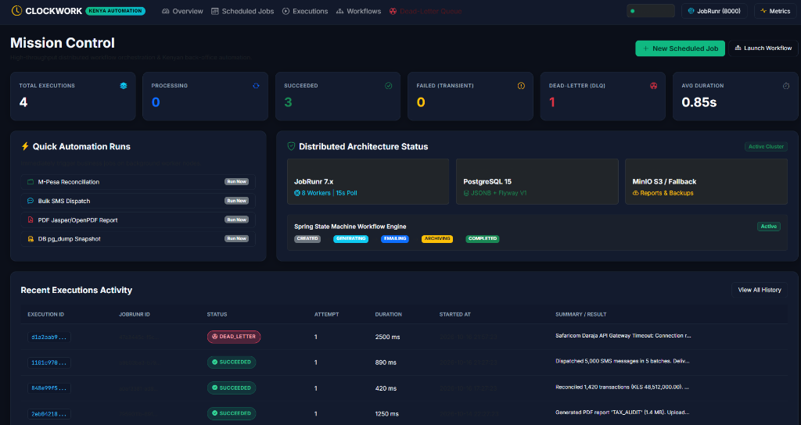
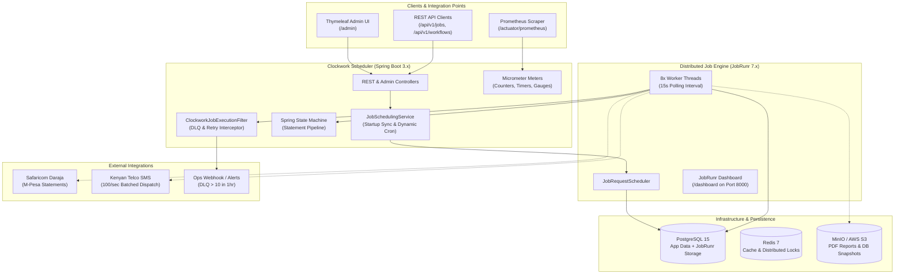
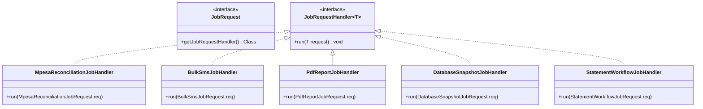
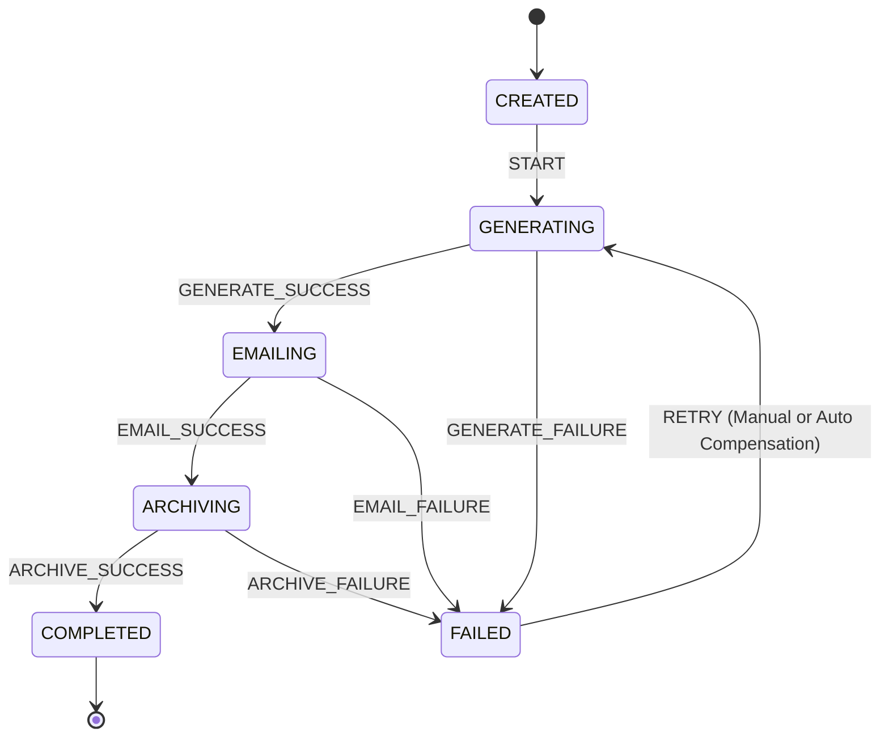
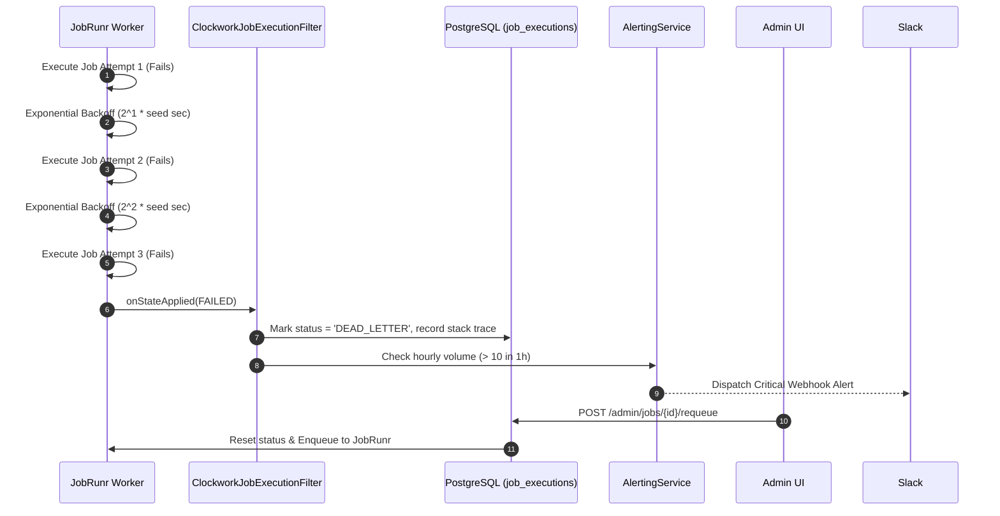

# 🕰️ Clockwork Scheduler

> **High-Throughput Distributed Job Scheduling & Kenyan Workflow Automation Engine**  
> Built with **Spring Boot 3.2**, **JobRunr 7.2**, **PostgreSQL 15 (JSONB)**, **Redis 7**, **Spring State Machine 3.2**, and **OpenPDF / S3 Storage**.

[](https://github.com/crnjihia/clockwork-scheduler/releases)
[](https://crnjihia.github.io/clockwork-scheduler/)
[](https://openjdk.org/)
[](https://spring.io/projects/spring-boot)
[](https://www.jobrunr.io/)
[](https://www.postgresql.org/)
[](https://redis.io/)
[](LICENSE)

---

## 📸 Live Mission Control Dashboard

Clockwork Scheduler's real-time administrative interface provides unified visibility into distributed worker nodes, execution latency metrics, DLQ status, and Kenya back-office operations:



*Live Mission Control UI running in Nairobi EAT mode: displaying 4 executions (3 succeeded, 1 isolated in DLQ with full diagnostic stack traces), active JobRunr background workers, and PostgreSQL/MinIO connectivity status.*

---

## 📌 Executive Summary

**Clockwork Scheduler** is an enterprise-grade distributed job orchestration platform designed to automate mission-critical, recurring back-office workflows for Kenyan businesses—eliminating fragile cron scripts and unmonitored background tasks.

Unlike legacy Quartz architectures, Clockwork utilizes **JobRunr 7.x** for distributed worker coordination across master-worker clusters, backed by **PostgreSQL 15** for persistent storage, **Flyway** for database migrations, and **Spring State Machine** for resilient multi-stage financial transactions.

### 🌐 Interactive Web Showcase
Explore the live interactive simulator, cron expression calculator, and Kenya enterprise workflow blueprints on our **[GitHub Pages Showcase Site](https://crnjihia.github.io/clockwork-scheduler/)**.

---

## 🖼️ Additional Dashboard Views

| View | Path | Description |
| :--- | :--- | :--- |
| **Workflow Pipeline** | [`/admin/workflows`](file:///c:/Users/crnji/Videos/Projects/Java/clockwork-scheduler/docs/images/workflows-pipeline.jpg) | Spring State Machine step progression (`CREATED → GENERATING → EMAILING → ARCHIVING → COMPLETED`) with step timeline inspection and single-click compensation retry. |
| **Dead-Letter Queue** | [`/admin/dlq`](file:///c:/Users/crnji/Videos/Projects/Java/clockwork-scheduler/docs/images/dlq-requeue.jpg) | Isolates jobs that exhausted all exponential retries, inspects exception stack traces, and provides instant requeuing. |

---

## 🏗️ System Architecture



---

## 🇰🇪 Kenyan Enterprise Workflows

Clockwork Scheduler comes pre-configured with the standard recurring workflows required by East African businesses:



### 1. `MpesaReconciliationJob`
* **Trigger:** Nightly at 03:00 AM EAT (`0 3 * * *`).
* **Workflow:** Ingests Safaricom Daraja C2B/B2C Paybill settlement transactions, cross-references with internal general ledger accounts, flags amount variances, and alerts on missing settlement receipts.

### 2. `BulkSmsJob`
* **Trigger:** Scheduled campaigns or on-demand dispatch (e.g. `0 9 * * 1-5` at 9:00 AM EAT).
* **Workflow:** Validates and normalizes Kenyan mobile numbers (`07...`, `01...` &rarr; `+254...`), partitions recipients into batches with a 50 ms rate-limiting delay to prevent telco carrier throttling, buffering failed recipients for automatic exponential retries.

### 3. `PdfReportJob`
* **Trigger:** On-demand or scheduled monthly tax/financial closing (`0 0 1 * *`).
* **Workflow:** Generates digitally styled PDF audit statements using OpenPDF, uploads byte streams directly to MinIO/S3 (`clockwork-reports/`), and emails download links to recipients.

### 4. `DatabaseSnapshotJob`
* **Trigger:** Nightly at 02:00 AM EAT (`0 2 * * *`).
* **Workflow:** Executes compressed PostgreSQL database snapshots (`.sql.gz`), uploads archives to S3 (`backups/db-snapshots/`), and enforces automated retention pruning—**retaining the last 30 snapshots** and purging older backups.

### 5. `StatementWorkflowJob`
* **Trigger:** Multi-step transactional pipeline orchestrated by **Spring State Machine 3.2**.
* **Workflow:** Linear progression across 4 guaranteed stages:
  1. **Generate**: Creates custom PDF account statement.
  2. **Email**: Encrypts and dispatches statement via SMTP.
  3. **Archive**: Streams copy to MinIO/S3 cold storage for 7-year regulatory retention.
  4. **Notify**: Dispatches SMS notification via Safaricom/Airtel SMS gateway.

---

## ⚡ Spring State Machine Workflow Execution



Every transition updates the `Workflow` entity and records individual execution latency and diagnostics in the `WorkflowStep` table with non-blocking reactive dispatch (`startReactively()`, `stopReactively()`, `sendEvent()`).

---

## 🛡️ Dead-Letter Queue (DLQ) & Exponential Retry Engine



1. **Exponential Retry Policy:** Configured via `new RetryFilter(3, 2)` (3 retries with exponential backoff seed of 2 seconds).
2. **Terminal Interception:** `ClockworkJobExecutionFilter` catches state transitions into `FailedState`.
3. **DLQ Persistence:** Moves execution record to `DEAD_LETTER` with complete root-cause exception stack trace.
4. **Volume Alerting:** Evaluates rolling 1-hour DLQ volume. If count exceeds **10 jobs/hour**, triggers high-priority Webhook alert to Slack / PagerDuty.
5. **Operator Requeue:** Operators can manually re-enqueue jobs via `POST /admin/jobs/{id}/requeue` or `POST /api/executions/{id}/requeue`.

---

## 🚀 Quickstart & Running the Application

### Option 1: Standalone Demo Mode (Zero Dependencies)
No Docker or external PostgreSQL required! Clockwork includes an in-memory H2 profile in PostgreSQL mode that automatically seeds all Kenya operations data:

```bash
# Run the pre-built standalone JAR
java -jar target/clockwork-scheduler-1.0.0-SNAPSHOT.jar --spring.profiles.active=demo
```

Access the application:
- **Admin Mission Control:** [http://localhost:8085/admin](http://localhost:8085/admin)
- **JobRunr Dashboard:** [http://localhost:8000/dashboard](http://localhost:8000/dashboard)
- **Credentials:** `admin` / `admin123`

---

### Option 2: Full Production Docker Stack
To run Clockwork alongside PostgreSQL 15, Redis 7, MinIO, Prometheus, and Grafana:

```bash
docker compose up -d
```

| Service | URL | Credentials |
|---|---|---|
| **Clockwork Admin UI** | [http://localhost:8080/admin](http://localhost:8080/admin) | `admin` / `admin123` |
| **JobRunr Dashboard** | [http://localhost:8000/dashboard](http://localhost:8000/dashboard) | None / Integrated |
| **Grafana Dashboard** | [http://localhost:3000](http://localhost:3000) | `admin` / `clockwork` |
| **Prometheus Console** | [http://localhost:9090](http://localhost:9090) | None |
| **MinIO Storage Console** | [http://localhost:9003](http://localhost:9003) | `minioadmin` / `minioadmin` |
| **PostgreSQL 15** | `localhost:5432` | `postgres` / `postgres` |

---

## 📡 REST API Reference

All endpoints support HTTP Basic Authentication (`admin` / `admin123`).

### 1. Trigger Scheduled Job
```bash
curl -X POST http://localhost:8085/api/v1/jobs/efff42ef-d8b4-47f1-8087-0f9bafe81c71/run \
  -u admin:admin123 \
  -H "Content-Type: application/json"
```

### 2. Initiate Multi-Step Statement Workflow
```bash
curl -X POST http://localhost:8085/api/v1/workflows \
  -u admin:admin123 \
  -H "Content-Type: application/json" \
  -d '{
    "customerId": "CUST-KE-254",
    "email": "finance@company.ke",
    "phone": "+254722000000"
  }'
```

### 3. Requeue Failed Job from DLQ
```bash
curl -X POST http://localhost:8085/api/v1/executions/d1a2aab9-1234-5678-abcd-ef0123456789/requeue \
  -u admin:admin123
```

---

## 📊 Observability & Metrics

Prometheus scrape endpoint exposed at `/actuator/prometheus`.

| Metric Name | Type | Description |
|---|---|---|
| `jobs.enqueued` | Counter | Total jobs registered in scheduling pipeline |
| `jobs.succeeded` | Counter | Total successful job runs |
| `jobs.failed` | Counter | Transient execution failures |
| `jobs.deadletter` | Counter | Permanent failures moved to DLQ |
| `job.duration` | Timer | Latency distribution tagged by `job_type` |
| `queue.depth` | Gauge | Instantaneous enqueued jobs from `StorageProvider` |

---

## 🧪 Testing Suite

Execute the automated test suite containing unit tests, Testcontainers integration tests, state machine verification, and cron parser assertions:

```bash
.\mvnw.cmd test
```

- **`JobHandlersUnitTest`**: Validates execution recording, mock payload processing, and failure simulation for all 5 handlers.
- **`StatementStateMachineTest`**: Tests non-blocking state transitions (`CREATED → GENERATING → EMAILING → ARCHIVING → COMPLETED`) and `RETRY` resumption.
- **`CronParsingTest`**: Tests valid Quartz 6-part expressions and validates calculation of next EAT timestamps.
- **`JobSchedulingIntegrationTest`**: Boots PostgreSQL, registers a ScheduledJob, triggers execution, and verifies database persistence.

---

## 📖 Deliverables & Documentation Links

- **[GitHub Pages Interactive Web Showcase](https://crnjihia.github.io/clockwork-scheduler/)**
- **[Sample Cron Expressions Guide](docs/cron-expressions.md)**
- **[Postman API Collection](docs/postman/Clockwork_Scheduler.postman_collection.json)**
- **[Grafana Dashboard Definition](docker/grafana/dashboards/clockwork-scheduler.json)**
- **[Release Notes & Changelog](CHANGELOG.md)**

---

## 📄 License

This project is licensed under the MIT License — see the [LICENSE](LICENSE) file for details.
