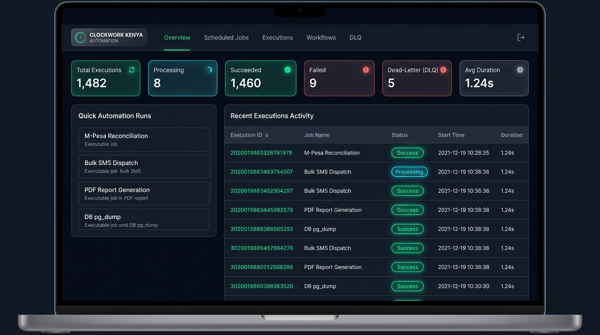
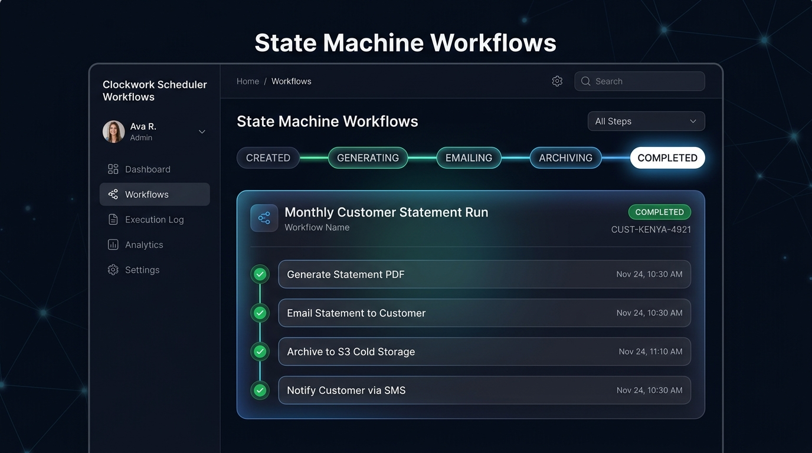
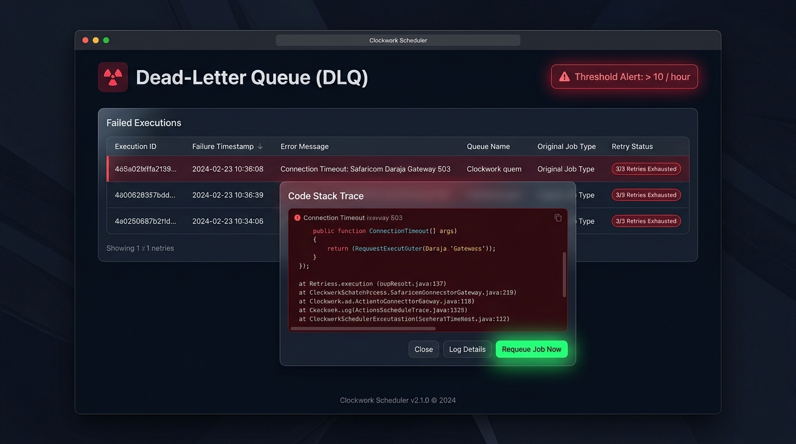
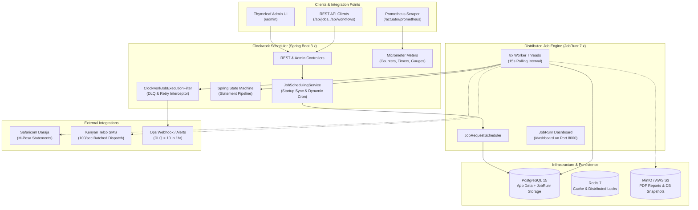
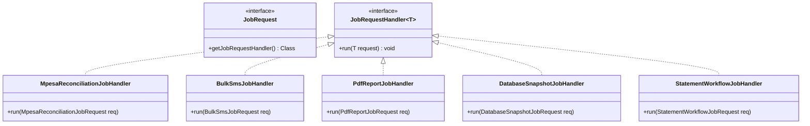
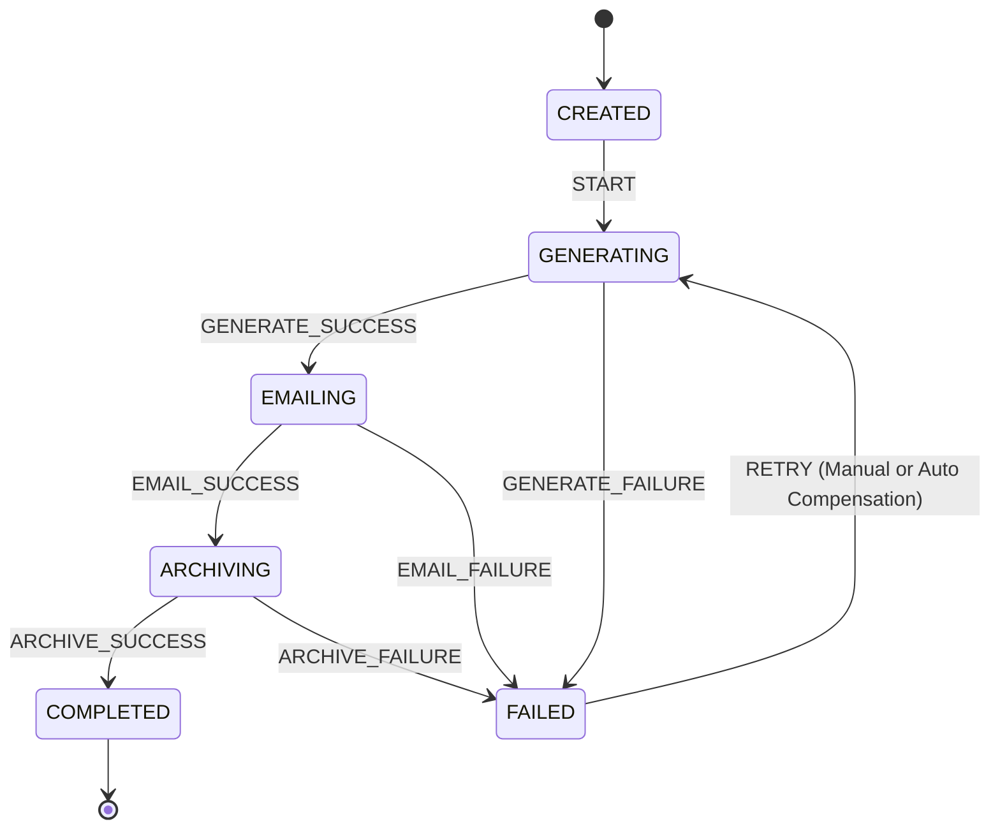
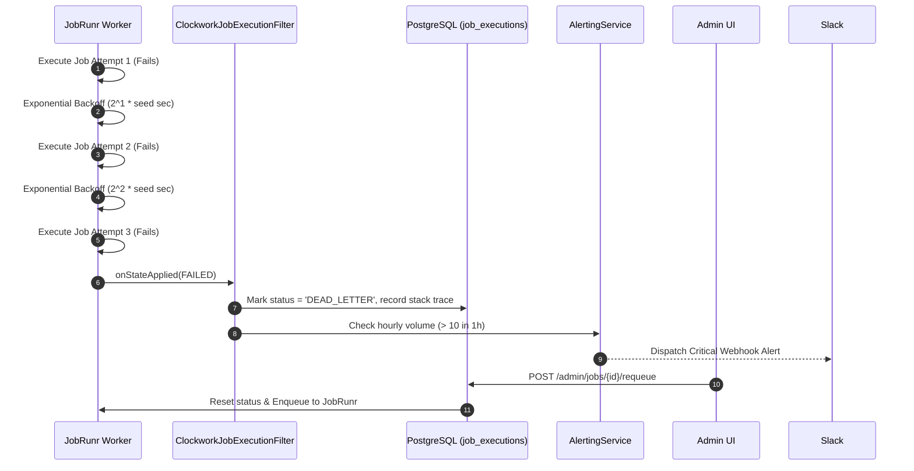

# 🕰️ Clockwork Scheduler

> **Distributed Job Scheduling & Workflow Automation Platform for Kenyan Enterprises**  
> Built with **Spring Boot 3.x**, **JobRunr 7.x**, **PostgreSQL 15 (JSONB)**, **Redis 7**, **Spring State Machine**, and **OpenPDF / S3 Storage**.

[](https://openjdk.org/)
[](https://spring.io/projects/spring-boot)
[](https://www.jobrunr.io/)
[](https://www.postgresql.org/)
[](https://redis.io/)
[](https://prometheus.io/)
[](https://www.docker.com/)

---

## 📌 Executive Summary

**Clockwork Scheduler** is an enterprise-grade distributed job orchestration platform designed to automate mission-critical, recurring back-office workflows for Kenyan businesses—eliminating fragile cron scripts and unmonitored background tasks. 

Unlike legacy Quartz architectures, Clockwork utilizes **JobRunr 7.x** for distributed worker coordination, backed by **PostgreSQL 15** for persistent storage, **Flyway** for database migrations, and **Spring State Machine** for resilient multi-stage transactions.

---

## 🖼️ Admin Dashboard Previews

### 1. Mission Control Overview (`/admin`)
Real-time execution telemetry, live SSE event streaming, JobRunr queue depth gauge, and one-click quick triggers.



### 2. Multi-Step State Machine Workflows (`/admin/workflows`)
Visual state progression (`CREATED → GENERATING → EMAILING → ARCHIVING → COMPLETED`) with step timeline inspection and manual compensation retry.



### 3. Dead-Letter Queue & Diagnostic Requeuer (`/admin/dlq`)
Isolates jobs that exhausted all exponential retries, inspects exception stack traces, and provides instant requeuing.



---

## 🏗️ System Architecture



---

## 🔄 Core Use Cases & Handlers

All jobs implement JobRunr's `JobRequest` and `JobRequestHandler` pattern with `@Job(name = "...", retries = 3)`:



### 1. `MpesaReconciliationJob`
* **Trigger:** Nightly at 02:00 AM (`0 0 2 * * ?`).
* **Workflow:** Ingests Daraja Paybill settlement transactions, cross-references with internal general ledger accounts, flags amount variances or missing receipts above threshold (e.g., KES 5,000), and dispatches executive settlement audit reports to `settlements@clockwork.co.ke`.

### 2. `BulkSmsJob`
* **Trigger:** Scheduled campaigns or on-demand dispatch.
* **Workflow:** Validates and normalizes Kenyan mobile numbers (`07...`, `01...` &rarr; `+254...`), partitions recipients into batches of 100 with a configurable 1s rate-limiting delay, and monitors delivery reports.

### 3. `PdfReportJob`
* **Trigger:** On-demand or scheduled tax/financial closing.
* **Workflow:** Generates digitally styled PDF audit statements using OpenPDF, uploads byte streams directly to MinIO/S3 (`clockwork-reports/`), and emails download links to recipients.

### 4. `DatabaseSnapshotJob`
* **Trigger:** Nightly at 01:30 AM (`0 30 1 * * ?`).
* **Workflow:** Executes compressed PostgreSQL database snapshots (`.sql.gz`), uploads archives to S3 (`backups/db-snapshots/`), and enforces automated retention pruning—**retaining the last 30 snapshots** and deleting older backups.

### 5. `StatementWorkflowJob`
* **Trigger:** Monthly on the 1st at 06:00 AM (`0 0 6 1 * ?`).
* **Workflow:** Orchestrated by **Spring State Machine** across four guaranteed stages.

---

## ⚡ State Machine Workflow Execution



Every transition updates the `Workflow` entity and records individual execution latency and diagnostics in the `WorkflowStep` table.

---

## 🛡️ Dead-Letter Queue (DLQ) & Exponential Retry Policy



1. **Exponential Retry Configuration:** JobRunr configured with `new RetryFilter(3, 2)`.
2. **Terminal Interception:** `ClockworkJobExecutionFilter` catches state transitions into `FailedState`.
3. **DLQ Persistence:** Moves execution record to `DEAD_LETTER` with complete root-cause exception stack trace.
4. **Volume Alerting:** Evaluates rolling 1-hour DLQ volume. If count exceeds **10 jobs/hour**, triggers high-priority Webhook alert.
5. **Operator Requeue:** Operators can manually re-enqueue jobs via `POST /admin/jobs/{id}/requeue` or `POST /api/executions/{id}/requeue`.

---

## 📊 Observability & Metrics

Prometheus scrape endpoint exposed at `/actuator/prometheus`.

| Metric Name | Type | Description |
|---|---|---|
| `jobs.enqueued` | Counter | Total jobs registered in scheduling pipeline |
| `jobs.succeeded` | Counter | Total successful job runs |
| `jobs.failed` | Counter | Transient execution failures |
| `jobs.deadletter` | Counter | Permanent failures moved to DLQ |
| `job.duration` | Timer | Latency distribution tagged by `job_type` |
| `queue.depth` | Gauge | Instantaneous enqueued jobs from `StorageProvider` |

A production-ready Grafana dashboard is located at [`docker/grafana/dashboards/clockwork-scheduler.json`](file:///c:/Users/crnji/Videos/Projects/Java/clockwork-scheduler/docker/grafana/dashboards/clockwork-scheduler.json).

---

## 🚀 Quickstart & Docker Compose

### Prerequisites
- Docker Engine & Docker Compose
- Java 17 or 21 (optional for local non-containerized build)

### Running the Full Stack
To spin up Clockwork Scheduler alongside PostgreSQL 15, Redis 7, MinIO, Prometheus, and Grafana:

```bash
docker compose up -d --build
```

### Port Mappings & Services
| Service | URL | Credentials |
|---|---|---|
| **Clockwork Admin UI** | [http://localhost:8080/admin](http://localhost:8080/admin) | None (Public UI) |
| **JobRunr Dashboard** | [http://localhost:8000/dashboard](http://localhost:8000/dashboard) | `admin` / `admin123` |
| **Grafana Dashboard** | [http://localhost:3000](http://localhost:3000) | `admin` / `clockwork` |
| **Prometheus Console** | [http://localhost:9090](http://localhost:9090) | None |
| **MinIO Console** | [http://localhost:9003](http://localhost:9003) | `minioadmin` / `minioadmin` |
| **PostgreSQL 15** | `localhost:5434` | `postgres` / `postgres` |

---

## 🧪 Testing Suite

Execute the automated test suite containing unit tests, Testcontainers integration tests, state machine verification, and cron parser assertions:

```bash
.\mvnw.cmd test
```

### Test Coverage Highlights
* **`JobHandlersUnitTest`**: Validates execution recording, mock payload processing, and failure simulation for all 5 handlers.
* **`StatementStateMachineTest`**: Tests state transition sequence (`CREATED → GENERATING → EMAILING → ARCHIVING → COMPLETED`) and `RETRY` resumption.
* **`CronParsingTest`**: Tests valid Quartz 6-part expressions and validates calculation of next EAT timestamps.
* **`JobSchedulingIntegrationTest`**: Boots Testcontainers PostgreSQL, registers a ScheduledJob, triggers execution, and verifies database persistence.

---

## 📖 Additional Documentation
* [Sample Cron Expressions Guide](file:///c:/Users/crnji/Videos/Projects/Java/clockwork-scheduler/docs/cron-expressions.md)
* [Postman API Collection](file:///c:/Users/crnji/Videos/Projects/Java/clockwork-scheduler/docs/postman/Clockwork_Scheduler.postman_collection.json)
* [Grafana Dashboard Definition](file:///c:/Users/crnji/Videos/Projects/Java/clockwork-scheduler/docker/grafana/dashboards/clockwork-scheduler.json)
